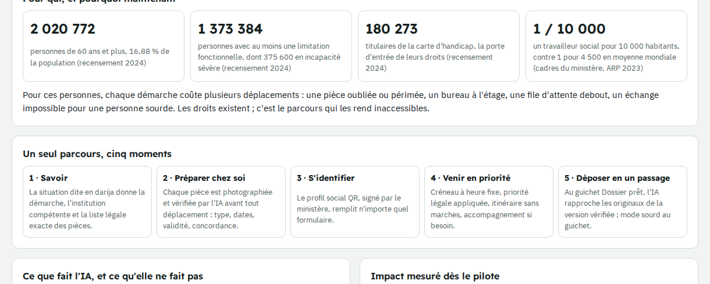
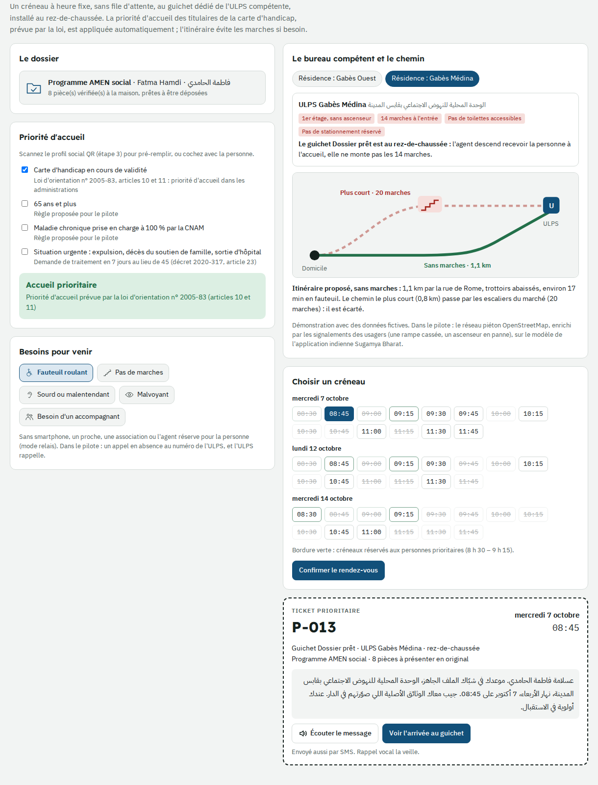
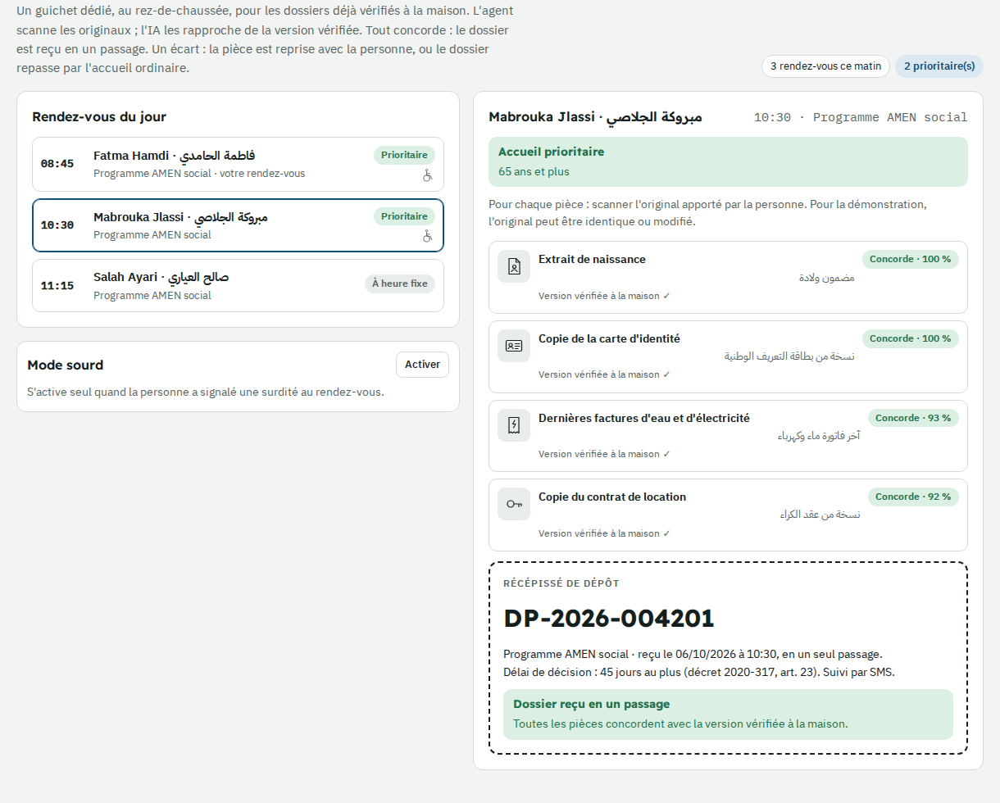
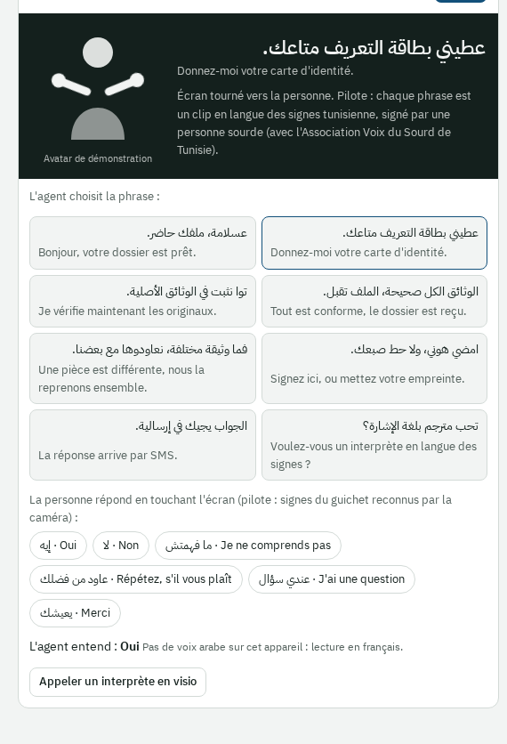
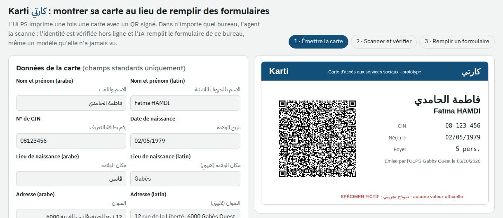
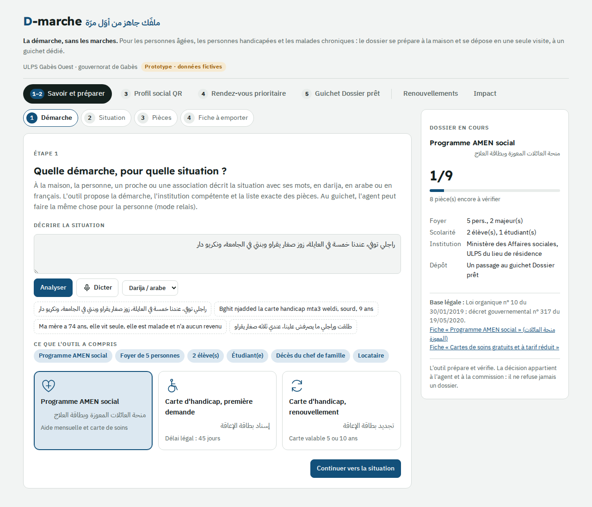
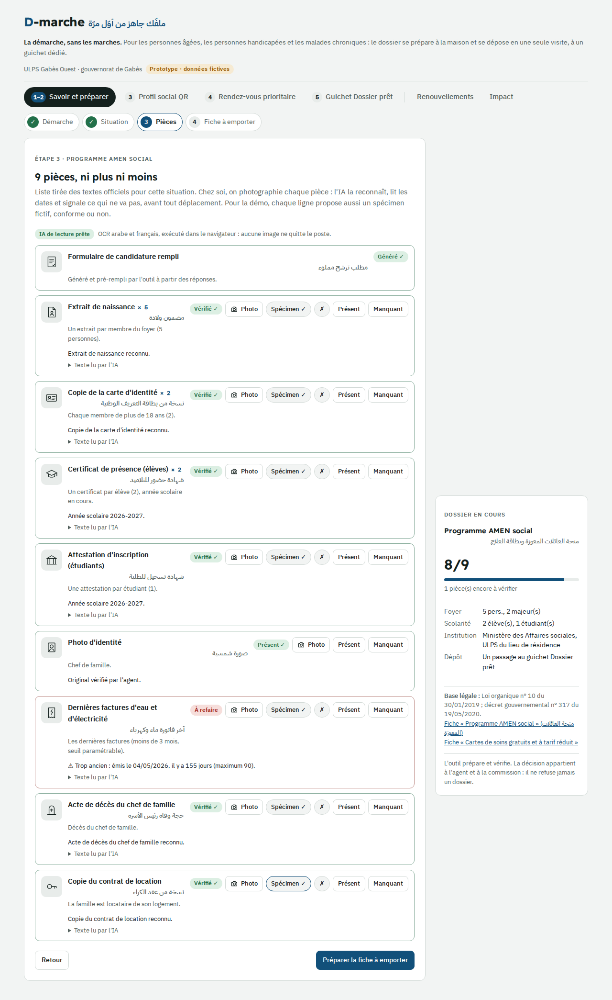
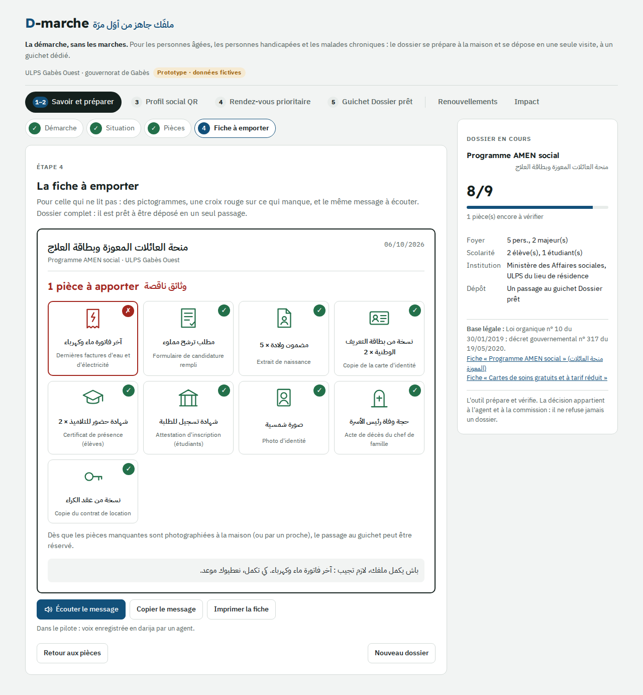
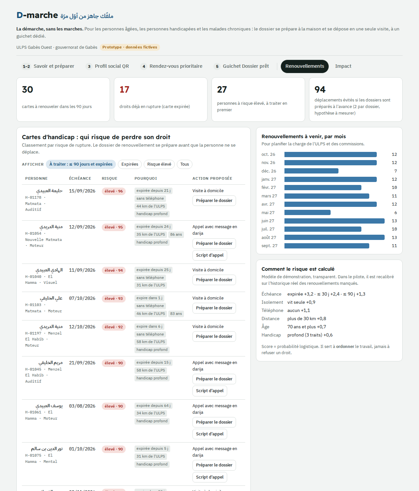

# D-marche : la démarche, sans les marches

**دوسيك حاضر من أوّل مرّة** · le dossier social prêt en un seul passage

Prototype pour le **Social Tech Challenge 2026** (PNUD, Banque mondiale, ministère des Affaires sociales), **Parcours 1, Défi 2 : digitalisation du dépôt des dossiers**.

**Pour les personnes âgées, les personnes handicapées et les malades chroniques : le dossier se prépare à la maison et se dépose en une seule visite, à un guichet dédié.** L'application sert à la personne, à un proche, à une association ou à l'agent de l'ULPS (mode relais) : elle n'exige de la personne ni lecture ni smartphone.

## Née d'un besoin vécu

D-marche n'est pas une technologie à la recherche d'un problème. L'idée vient d'un membre de l'équipe, en situation de handicap et usager du régime APCI de la CNAM, qui a vécu chaque étape de ces démarches. Pas d'étude menée derrière un écran : il a nommé les blocages, nous les avons résolus un par un, et il teste chaque écran en premier. Les personnes concernées ne sont pas seulement les utilisateurs de la solution : elles en sont la source. Comme on dit chez nous : *« ما يحسّ بالجمرة كان اللي يعفس عليها »*, seul celui qui marche sur la braise en sent la brûlure.

| Blocage vécu | Réponse de D-marche |
|---|---|
| Ne pas savoir quelles pièces fournir ni à quel bureau s'adresser | La liste exacte et l'institution compétente (moment 1) |
| Revenir pour une pièce manquante, périmée ou pas sur le bon modèle | Le contrôle de chaque pièce à la maison (moment 2) |
| Recopier les mêmes informations sur chaque formulaire | Le profil social QR (moment 3) |
| Attendre debout sans savoir quand on sera reçu | Le créneau à heure fixe et la priorité légale (moment 4) |
| Multiplier les allers-retours pour un seul dossier | Le dépôt en un passage (moment 5) |
| Laisser passer la date de renouvellement | L'alerte avant échéance (onglet Renouvellements) |
| Dépendre de la famille à chaque étape | Des écrans en phrases simples et le mode relais |

## Pourquoi

- 2 020 772 personnes de 60 ans et plus (16,88 % de la population), 1 373 384 personnes avec une limitation fonctionnelle dont 375 600 en incapacité sévère, 180 273 titulaires de la carte d'handicap (recensement 2024).
- Un travailleur social pour 10 000 habitants (cadres du ministère, audition à l'ARP, 2023) : chaque dossier incomplet consomme un créneau rare.
- Les droits existent, y compris la priorité d'accueil des titulaires de la carte d'handicap (loi d'orientation n° 2005-83, articles 10 et 11). C'est le parcours qui les rend inaccessibles : pièce oubliée ou périmée, bureau à l'étage, file d'attente debout, échange impossible pour une personne sourde.

## Un seul parcours, cinq moments

| Moment | Ce que fait la personne | Ce que fait l'IA |
|---|---|---|
| 1. Savoir | Elle dit sa situation en darija, en arabe ou en français | Démarche, institution compétente et liste légale exacte des pièces, tirée des textes du ministère |
| 2. Préparer chez soi | Elle photographie ses pièces | OCR arabe et français : type de pièce, dates, validité, année scolaire, modèle du certificat médical |
| 3. S'identifier | Elle montre son profil social QR | QR signé (ECDSA) vérifié hors ligne ; remplit n'importe quel formulaire, même inconnu |
| 4. Venir en priorité | Elle réserve un créneau | Priorité légale appliquée, itinéraire sans marches, urgence en 7 jours (décret 2020-317, art. 23) |
| 5. Déposer en un passage | Elle remet les originaux au guichet « Dossier prêt » | Rapprochement des originaux avec la version vérifiée ; mode sourd au guichet |

| Guichet Dossier prêt | Mode sourd |
|---|---|
|  |  |

| Savoir | Préparer chez soi | Fiche à emporter | Renouvellements |
|---|---|---|---|
|  |  |  |  |

## Ce que montre le prototype

- **Savoir et préparer** : quatre exemples en darija, arabe et français ; liste des pièces pour AMEN et la carte d'handicap (première demande, renouvellement) ; spécimens fictifs conformes ou non, lus réellement par l'OCR.
- **Profil social QR** : émission, scan, carte falsifiée refusée, remplissage de trois formulaires dont un modèle inconnu (le formulaire de carte d'handicap reçoit aussi le numéro CNAM).
- **Rendez-vous prioritaire** : priorité pré-remplie depuis le QR, choix du bureau compétent, schéma d'itinéraire sans marches, créneaux réservés, ticket et message vocal en darija.
- **Guichet Dossier prêt** : file du jour, rapprochement des originaux (identique ou modifié pour la démo), récépissé, mode sourd avec les phrases du guichet et les réponses de la personne.
- **Renouvellements** et **Impact** : radar des cartes d'handicap à renouveler, chiffres clés, indicateurs du pilote, sources.

**Tests du prototype** (données fictives) : 8 pièces AMEN rapprochées, un original modifié détecté (date de facture) ; quatre pièces d'un autre dossier toutes concordantes et récépissé émis ; formulaires remplis à partir du QR (9 champs sur le formulaire de carte d'handicap, CNAM compris) ; carte falsifiée refusée.

## Essayer

- En ligne : activez GitHub Pages (Settings › Pages › branche `main`, dossier racine) et ouvrez `https://<identifiant>.github.io/d-marche/`.
- En local : servez le dossier (`python3 -m http.server`) puis ouvrez `http://localhost:8000`. Liens directs : `#karti`, `#rdv`, `#guichet`, `#method`.

## IA proportionnée, à périmètre contrôlé

- Compréhension du darija : Whisper affiné sur le dialecte tunisien dans le pilote ; analyse par lexique dans ce prototype.
- Moteur de règles tiré des fiches et textes du ministère (loi organique 10/2019, décrets 317/2020 et 3086/2005) : lui seul détermine les pièces. Le modèle de langage reformule, il ne décide jamais.
- Compréhension de documents arabe et français (Tesseract dans le prototype) et rapprochement physique-numérique (dates, numéros, texte).
- L'IA peut dire oui, jamais non : toute décision reste à l'agent et à la commission.

## Déployable dans l'existant

- Un guichet, pas un nouveau système : un agent quelques demi-journées par semaine, au rez-de-chaussée de l'ULPS.
- Complète l'application gouvernementale Khadamet (lancée le 31 août 2026, services CNAM et CNSS via l'identité numérique), l'Espace citoyen du ministère (carte d'invalidité en ligne, décembre 2025) et la plateforme AMEN, pour celles et ceux qui ne peuvent pas s'en servir seuls ; le profil social QR peut s'appuyer sur l'identité numérique de Khadamet.
- La CNSS, la CNRPS et la CNAM relèvent de la tutelle du ministère des Affaires sociales : le profil QR réunit leurs identifiants.
- Modèles open source, données hébergées par le ministère, aucune donnée de santé dans le QR, contrôle de l'INPDP.
- Inspiré de l'application indienne Sugamya Bharat (personnes handicapées et âgées), adapté au droit et à la langue tunisiens.
- Phase 2 : bénévoles vérifiés par des associations, signalements d'accessibilité par les usagers, procédures CNSS, CNRPS et CNAM, appel en absence pour les téléphones simples.

**Toutes les personnes et tous les documents du prototype sont fictifs.** La clé de signature de démonstration est dans la page ; en production, la clé privée reste au ministère.

---

**English summary.** D-marche ("the procedure, without the steps") is a prototype for Tunisia's Social Tech Challenge 2026 (Challenge 2, file submission). It was designed from lived experience: a team member with a disability named the blockages he faced in his own procedures, and each feature answers one of them. For older people, people with disabilities and people with chronic illness: the social-aid file is prepared at home and handed in during a single visit to a dedicated ground-floor counter. Five moments: know (exact legal document list from darija speech), prepare at home (Arabic/French OCR checks of each document), identify (ministry-signed QR social profile that fills any form), come with priority (legal priority applied, step-free route, 7-day track for urgent cases) and hand in once (AI reconciles the originals with the home-checked versions; deaf mode at the counter). Fictional data only.
